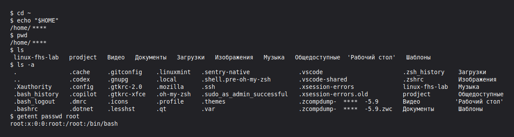
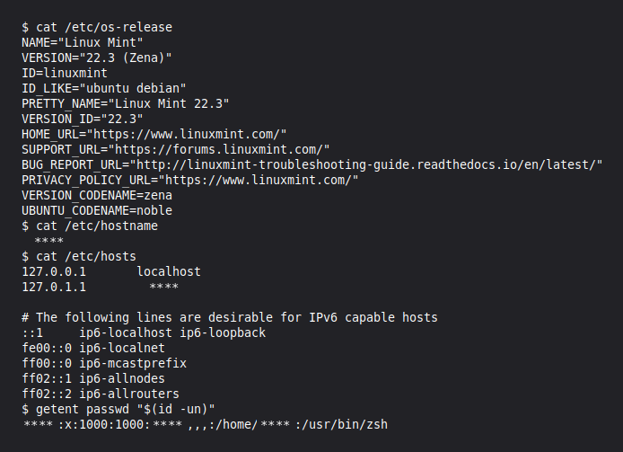
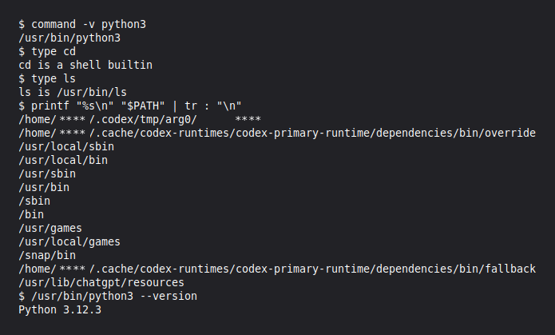
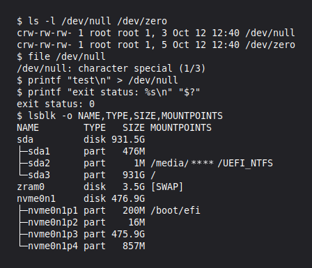
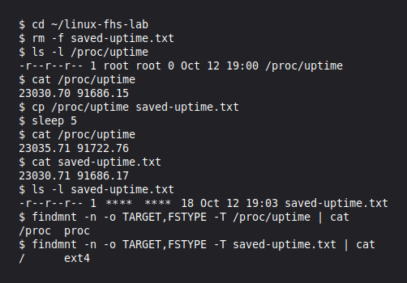
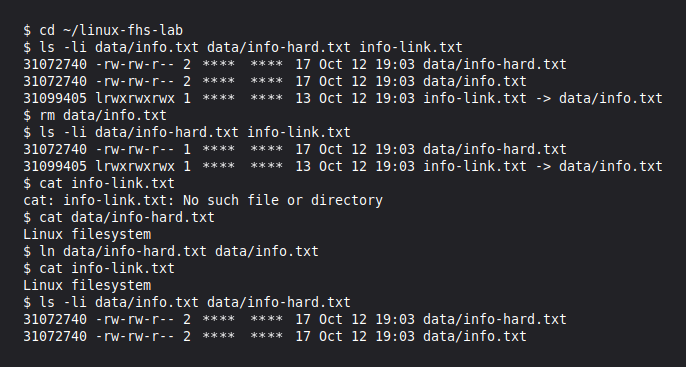
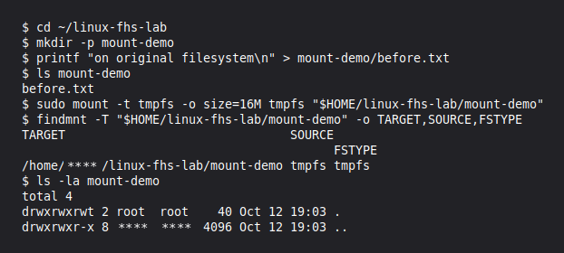

# Файловая система Linux · отчёт

Среда: установленная Linux Mint 22.3 (Zena), MATE Terminal.
Личные данные в тексте, логах и снимках заменены на `****`.

## Корневой каталог

Команды:

```bash
pwd
ls -lah /
```


Результат:

pwd показала текущий путь /, а ls -lah / вывела содержимое корневого каталога вместе со скрытыми записями, правами доступа, владельцами и размерами.

Что такое корневой каталог, чем абсолютный путь отличается от относительного.

Вывод: Корневой каталог / служит началом дерева файловой системы. Абсолютный путь начинается с /, а относительный отсчитывается от текущего каталога.

## Домашний каталог

Команды:

```bash
cd ~
pwd
ls -a
```



Результат:

cd ~ перешла в домашний каталог, pwd показала его путь, а ls -a вывела обычные и скрытые файлы.

Где находится домашний каталог, что такое скрытые файлы.

Вывод: Домашний каталог этого пользователя находится внутри /home. Имена скрытых файлов начинаются с точки, а увидеть их можно с помощью ls -a.

## Каталог /etc

Команды:

```bash
cat /etc/os-release
getent passwd
```



Результат:

cat /etc/os-release показала сведения о Linux Mint 22.3, а getent passwd вывела записи пользователей с их UID, домашними каталогами и оболочками.

Версия системы, UID, домашний каталог и оболочка.

Вывод: В системе установлена Linux Mint 22.3, UID пользователя равен 1000, а домашний каталог находится внутри /home. Пользователь работает с оболочкой /usr/bin/zsh.

## Программы и PATH

Команды:

```bash
command -v python3
type cd
type ls
echo "$PATH"
```



Результат:

command -v показала путь /usr/bin/python3, а type определила cd как встроенную команду и ls как программу /usr/bin/ls. echo вывела список каталогов из PATH.

Как оболочка находит программу.

Вывод: Оболочка ищет внешнюю программу в каталогах PATH слева направо и запускает первую найденную. Встроенные команды, например cd, выполняются самой оболочкой.

## Изменяемые данные

Команды:

```bash
ls /var
findmnt -T /run
```


Результат:

ls показала содержимое /var, а findmnt определила, что /run расположен в файловой системе tmpfs.

Назначение /var/lib, /var/log, /var/cache и /run.

Вывод: В /var/lib хранятся постоянные данные программ, в /var/log журналы, а в /var/cache кэш. Каталог /run содержит временные данные текущего запуска системы.

## Устройства

Команды:

```bash
ls -l /dev/null
echo $?
```



Результат:

ls -l показала, что /dev/null является символьным устройством, а echo вывела код завершения 0.

Тип устройства и код завершения.

Вывод: Буква c в начале строки ls -l обозначает символьное устройство. Код завершения 0 означает успешное выполнение предыдущей команды.

## Файлы /proc

Команды:

```bash
cat /proc/uptime
cp /proc/uptime saved-uptime.txt
sleep 5
cat /proc/uptime
cat saved-uptime.txt
```



Результат:

cat прочитала значения из /proc/uptime, а cp сохранила их в saved-uptime.txt. После паузы новые значения /proc/uptime изменились, но содержимое копии осталось прежним.

Почему копия не меняется.

Вывод: Ядро формирует содержимое /proc/uptime при каждом чтении. Копия является обычным файлом и хранит значения, полученные в момент копирования.

## Сетевые интерфейсы

Команды:

```bash
ls /sys/class/net
```


Результат:

ls вывела имена сетевых интерфейсов из /sys/class/net, включая lo, wlp2s0 и интерфейс со скрытым в отчёте именем.

Какие интерфейсы есть в системе.

Вывод: В системе есть интерфейсы lo, wlp2s0 и ещё один интерфейс, имя которого скрыто. Интерфейс lo используется для локального обмена внутри компьютера.

## inode и ссылки

Команды:

```bash
ls -li data/info.txt data/info-hard.txt info-link.txt
rm data/info.txt
cat info-link.txt
cat data/info-hard.txt
```



Результат:

ls -li показала одинаковый inode у info.txt и info-hard.txt. После удаления info.txt символическая ссылка info-link.txt перестала открываться, а чтение info-hard.txt по-прежнему вывело Linux filesystem.

Чем жёсткая ссылка отличается от символической.

Вывод: Жёсткая ссылка указывает на тот же inode и сохраняет доступ к данным после удаления другого имени файла. Символическая ссылка хранит путь и перестаёт работать, если файл по этому пути удалён.

## Место на диске

Команды:

```bash
findmnt /
df -h .
du -sh data
```


Результат:

findmnt определила корневую файловую систему ext4 на /dev/sda3, а df показала её общий объём, занятое и доступное место. du оценила место, занятое каталогом data, в 8 КиБ.

Чем df отличается от du.

Вывод: df показывает использование места всей файловой системой. du подсчитывает место, занятое указанными файлами и каталогами.

## Монтирование tmpfs

Команды:

```bash
findmnt -T mount-demo
```



Результат:

findmnt показала, что в mount-demo смонтирована tmpfs. После монтирования прежний файл before.txt перестал отображаться в этом каталоге.

Почему before.txt перестал быть виден.

Вывод: Смонтированная tmpfs скрыла прежнее содержимое каталога mount-demo. Файл before.txt остался на исходной файловой системе и не был удалён.

## Отключение tmpfs

Команды:

```bash
cat mount-demo/before.txt
```


Результат:

После отключения tmpfs команда cat прочитала из mount-demo/before.txt строку on original filesystem. Исходный файл снова стал доступен, а созданный внутри tmpfs файл inside.txt больше не был виден.

Что стало с inside.txt.

Вывод: После отключения tmpfs её содержимое перестало быть доступно через mount-demo, поэтому inside.txt больше не виден. Каталог снова показывает исходный before.txt.

## Файлы shop-api

Команды:

```bash
find model-root -type f
```


Результат:

find нашла в model-root три обычных файла службы shop-api: настройки app.conf, данные info.txt и журнал app.log.

Почему выбран каждый каталог.

Вывод: Настройки размещены в /etc, постоянные данные в /var/lib, а журналы в /var/log. Для вручную установленной программы выбран /usr/local/bin, а для номера процесса /run.

## Размещение shop-api

| Файл | Путь | Основание |
|---|---|---|
| Исполняемый файл | `/usr/local/bin/shop-api` | Установлен вручную |
| Настройки | `/etc/shop-api/app.conf` | Конфигурация службы |
| База данных | `/var/lib/shop-api/database.db` | Постоянные изменяемые данные |
| Журнал | `/var/log/shop-api/app.log` | Записи о работе |
| Номер процесса | `/run/shop-api/shop-api.pid` | Данные текущего запуска |
| Промежуточные файлы | `/tmp` | Кратковременные данные |

## Итоговая задача

| Исходный путь | Решение и правильный путь | Основание, часть урока |
|---|---|---|
| `/home/admin/shop.log` | Заменить на `/var/log/shop-api/shop.log` | Журнал, часть 4 |
| `/usr/bin/config.json` | Заменить на `/etc/shop-api/config.json` | Настройки, часть 2 |
| `/tmp/database.db` | Заменить на `/var/lib/shop-api/database.db` | База должна сохраняться, часть 4 |
| `/etc/shop-api/app.conf` | Оставить | Настройки, часть 2 |
| `/var/log/shop-api/access.log` | Оставить | Журнал, часть 4 |
| `/var/lib/shop-api/database.db` | Оставить | Постоянные данные, часть 4 |

## Домашнее задание: backup-agent

| Файл | Путь | Основание |
|---|---|---|
| Программа | `/usr/local/bin/backup-agent` | Установлена вручную |
| Настройки | `/etc/backup-agent/agent.conf` | Конфигурация |
| Журнал | `/var/log/backup-agent/agent.log` | Результаты работы и ошибки |
| Список сделанных копий | `/var/lib/backup-agent/catalog.json` | Постоянные данные службы |
| Номер процесса | `/run/backup-agent/agent.pid` | Данные текущего запуска |

Сами копии следует хранить на постоянном носителе, например в `/mnt/backup`, если туда подключён отдельный диск.

## Перед сдачей

- [x] Практика выполнена в `~/linux-fhs-lab`, существующие файлы без указаний задания сохранены.
- [x] tmpfs отключена, `before.txt` снова доступен.
- [x] Все 13 снимков открываются, результаты кратко описаны обычным текстом.
- [x] На каждый вопрос дан короткий ответ в строке Вывод.
- [x] Работа сохранена в репозитории на постоянном диске.
