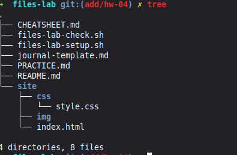
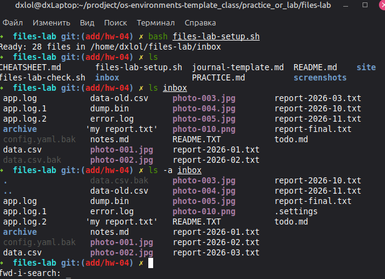
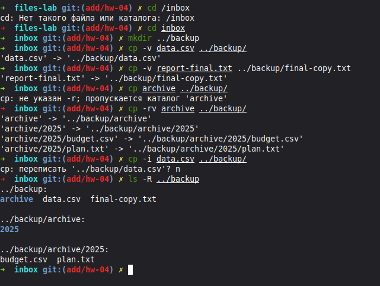
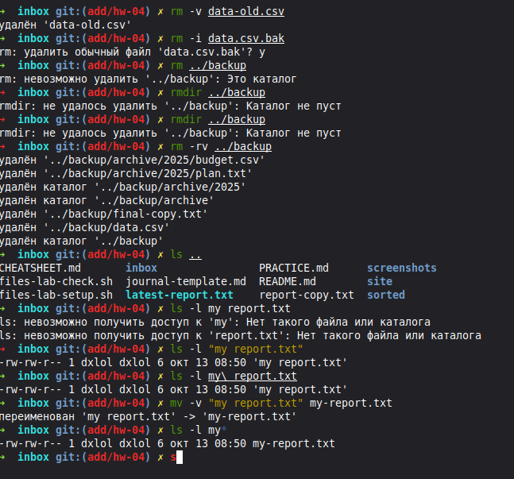
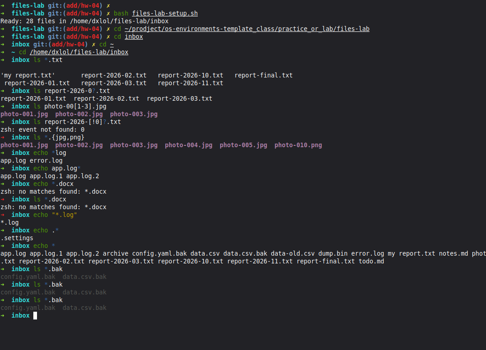
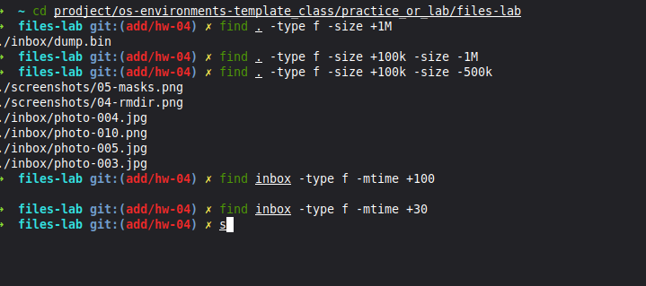
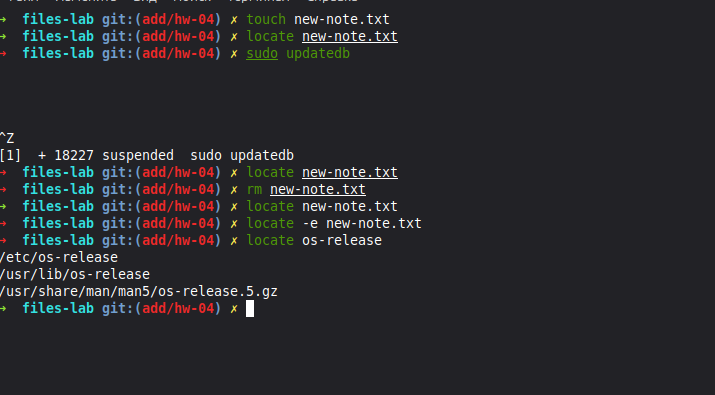
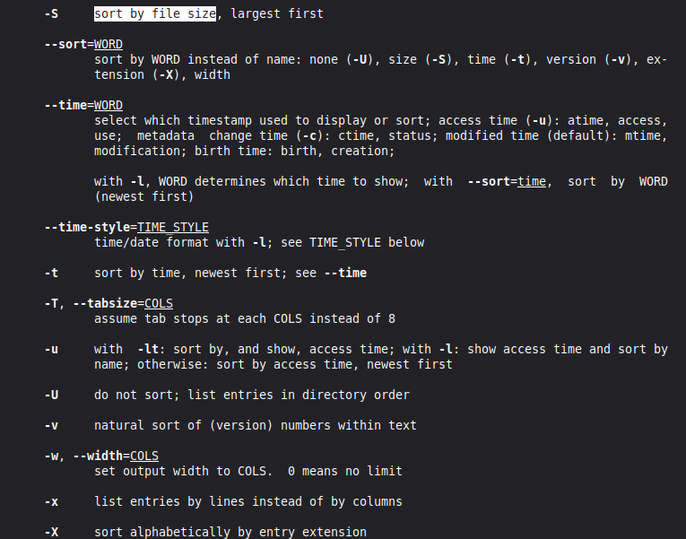
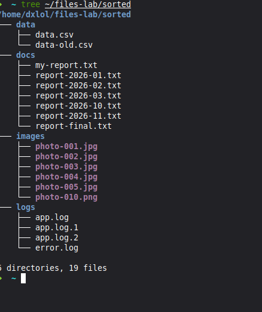
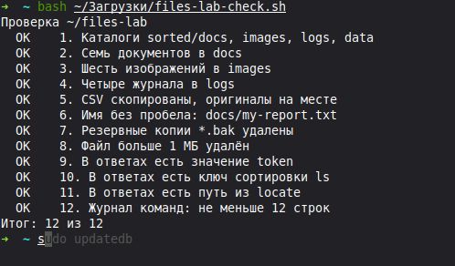

# Файлы, маски, поиск и справка · отчёт

Среда: Linux Mint 22.3 (Zena).

## Каталог site

Команды:

```bash
mkdir -p site/css site/img
touch site/index.html site/css/style.css
tree
```



Результат:

mkdir -p создала каталоги site/css и site/img вместе с родительским site. touch создала файлы index.html и style.css, а tree показала получившуюся структуру.

Почему mkdir без -p сообщил об ошибке.

Вывод: mkdir без -p сообщает об ошибке, если родительский каталог отсутствует или целевой каталог уже существует. Ключ -p создаёт недостающие родительские каталоги и допускает уже существующие.

## Учебный набор

Команды:

```bash
ls inbox
ls -a inbox
```



Результат:

ls inbox вывела обычные файлы и каталог archive из учебного набора. При выполнении ls -a inbox в списке появился скрытый файл .settings.

Какой файл виден только с ключом -A и почему.

Вывод: Файл .settings скрыт, потому что его имя начинается с точки. Ключ -A показывает скрытые файлы без записей . и .., а -a выводит и эти записи.

## Копирование с вопросом

Команды:

```bash
cp -i data.csv ../backup/
```



Результат:

cp -i запросила подтверждение перезаписи файла backup/data.csv. Ответ n отменил перезапись, поэтому существующая копия сохранилась.

Что сделает cp без -i, если файл уже есть.

Вывод: По умолчанию cp без -i перезаписывает существующий файл без запроса подтверждения, если позволяют права доступа.

## Удаление каталога

Команды:

```bash
rm -v data-old.csv
rm -i data.csv.bak
rm ../backup
rmdir ../backup
rm -rv ../backup
mv -v "my report.txt" my-report.txt
```



Результат:

rm удалила data-old.csv и data.csv.bak, а rmdir отказалась удалять непустой backup. rm -rv удалила backup вместе с содержимым, а mv переименовала my report.txt в my-report.txt.

Чем rmdir отличается от rm -r.

Вывод: rmdir удаляет только пустые каталоги. rm -r удаляет каталог вместе со всеми вложенными файлами и подкаталогами.

## Маски

Команды:

```bash
ls *.txt
ls photo-00[1-3].jpg
echo *.docx
```



Результат:

ls вывела текстовые файлы по маске *.txt и фотографии photo-001.jpg, photo-002.jpg и photo-003.jpg по маске photo-00[1-3].jpg. Для *.docx оболочка zsh сообщила об отсутствии совпадений.

Кто раскрывает маску и что получает команда, если совпадений нет.

Вывод: Маску раскрывает оболочка до запуска команды. В использованной zsh при отсутствии совпадений появляется ошибка no matches found, поэтому команда не запускается.

## Поиск find

Команды:

```bash
find . -type f -size +1M
find . -type f -size +100k -size -1M
find . -type f -size +100k -size -500k
find inbox -type f -mtime +30
```



Результат:

find нашла dump.bin размером больше 1 МиБ и несколько файлов в диапазоне от 100 до 500 КиБ. Условия -size +100k -size -1M и -mtime +30 в этом запуске не дали результатов.

Почему -size -1M не нашёл ни одного файла.

Вывод: При единице M команда find округляет размер вверх, поэтому условие -size -1M подходит только для пустых файлов и несовместимо с -size +100k. Для поиска файлов меньше 1 МиБ следует задать границу в байтах с -size -1048576c.

## Поиск locate

Команды:

```bash
locate new-note.txt
sudo updatedb
locate -e new-note.txt
locate os-release
```



Результат:

locate не нашла new-note.txt, а обновление базы командой sudo updatedb было приостановлено сочетанием Ctrl+Z из-за слишком долгого выполнения. Поиск os-release вывел пути /etc/os-release, /usr/lib/os-release и страницу справки.

Почему locate выводит путь удалённого файла.

Вывод: locate ищет по сохранённой базе путей, поэтому удалённый файл может оставаться в результатах до завершения обновления базы. Ключ -e проверяет существование найденных файлов.

## Справка

Команды:

```bash
man ls
```



Результат:

man ls открыла справку команды ls. Поиск по фразе sort by file size помог найти ключ -S для сортировки по размеру.

Какой ключ сортирует по размеру и как вы его нашли.

Вывод: Ключ -S сортирует файлы по размеру, начиная с самого большого. Он найден в man ls через поиск /sort by file size.

## Результат квеста

Команды:

```bash
tree ~/files-lab/sorted
```



Результат:

tree показала структуру sorted с каталогами data, docs, images и logs. В этих каталогах находится 19 файлов.

Сколько файлов в каждом подкаталоге.

Вывод: В docs находится 7 документов, в images 6 изображений, в logs 4 журнала, а в data 2 CSV-файла.

## Проверка

Команды:

```bash
bash ~/Загрузки/files-lab-check.sh
```



Результат:

Скрипт files-lab-check.sh завершил проверку с результатом 12 из 12. Все пункты отмечены как выполненные.

Итог проверки; какие пункты потребовали исправления.

Вывод: Итоговый запуск проверки подтвердил выполнение всех 12 пунктов и не выявил ошибок, требующих исправления.

## Ответы

Содержимое [answers.txt](answers.txt):

```text
./archive/2025/budget.csv
./archive/2025/plan.txt
./data-old.csv
token=lab-only
ls -l -S sorted/images
/etc/os-release
```

## Перед сдачей

- [x] Проверка: 12 из 12.
- [x] Снимки открываются.
- [x] [Журнал команд](journal.md) заполнен.
