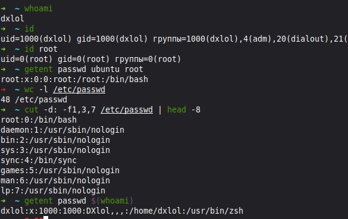
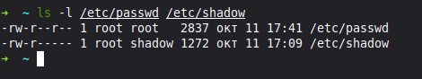
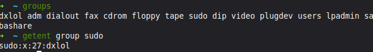
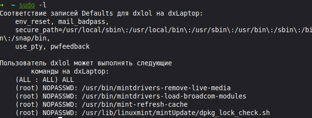
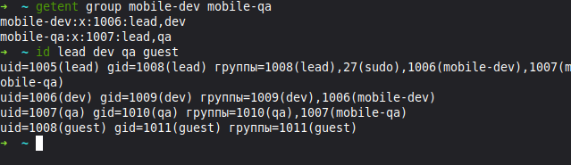
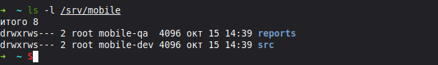
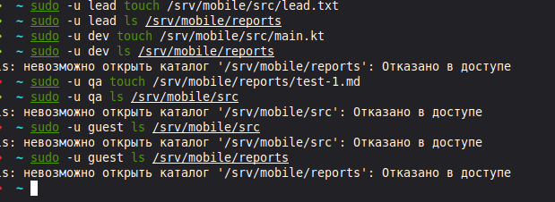
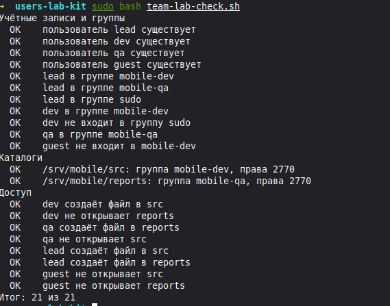
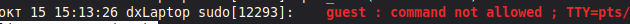

# Пользователи, группы и sudo · отчёт

Среда: Linux, оболочка zsh.

## Учётная запись

Команды:

```bash
id
getent passwd $(whoami)
```



Результат: пользователь `dxlol`, UID 1000, GID 1000; у root UID и GID равны 0. В `/etc/passwd` 48 записей.

Подпишите семь полей своей строки /etc/passwd.

Вывод: семь полей строки: `dxlol` — имя; `x` — хеш пароля хранится в `/etc/shadow`; `1000` — UID; `1000` — GID; комментарий с именем `Dxlol`; `/home/dxlol` — домашний каталог; `/usr/bin/zsh` — оболочка.

## passwd и shadow

Команды:

```bash
ls -l /etc/passwd /etc/shadow
```



Результат: `/etc/passwd` — `-rw-r--r--`, владелец `root:root`; `/etc/shadow` — `-rw-r-----`, владелец `root:shadow`.

Почему shadow закрыт для остальных пользователей.

Вывод: `/etc/shadow` содержит хеши паролей. Доступ ограничен root и группой shadow, чтобы остальные пользователи не могли подбирать пароли по хешам.

## Группы

Команды:

```bash
groups
getent group sudo
```



Результат: `dxlol` входит в несколько групп, включая `sudo`; запись группы — `sudo:x:27:dxlol`.

Где основная группа, где дополнительные.

Вывод: основная группа — `dxlol` (GID 1000 в `id`); остальные группы в выводе `groups` — дополнительные, в том числе `adm`, `dialout` и `sudo`.

## Правила sudo

Команды:

```bash
sudo -l
```



Результат: для `dxlol` разрешено `(ALL : ALL) ALL`; отдельные служебные команды разрешены с `NOPASSWD`.

Какое правило даёт вам права администратора.

Вывод: административные права даёт правило `%sudo ALL=(ALL:ALL) ALL`, поскольку `dxlol` состоит в группе `sudo`. Оно разрешает любые команды от имени любого пользователя и группы.

## Команда mobile-app

Команды:

```bash
getent group mobile-dev mobile-qa
id lead dev qa guest
```



Результат: `mobile-dev` (GID 1006) — `lead,dev`; `mobile-qa` (GID 1007) — `lead,qa`. `lead` также входит в `sudo`, у `guest` только личная группа.

Совпадают ли группы со схемой ролей.

Вывод: группы совпадают со схемой ролей: lead работает с кодом и отчётами, dev — с кодом, qa — с отчётами; guest доступа к проекту не имеет.

## Каталоги проекта

Команды:

```bash
ls -l /srv/mobile
```



Результат: `src` принадлежит `root:mobile-dev`, `reports` — `root:mobile-qa`. Оба каталога имеют права `drwxrws---` (2770).

Что означает каждая цифра в 2770.

Вывод: `2` — setgid: новые файлы наследуют группу каталога; первая `7` — владельцу доступны чтение, запись и вход; вторая `7` — те же права группе; `0` — остальным доступ закрыт.

## Тесты доступа

Команды:

```bash
sudo -u lead touch /srv/mobile/src/lead.txt
sudo -u lead ls /srv/mobile/reports
sudo -u dev touch /srv/mobile/src/main.kt
sudo -u dev ls /srv/mobile/reports
sudo -u qa touch /srv/mobile/reports/test-1.md
sudo -u qa ls /srv/mobile/src
sudo -u guest ls /srv/mobile/src
sudo -u guest ls /srv/mobile/reports
```



Результат: проверки 1, 2, 3 и 5 выполнены успешно; в проверках 4, 6, 7 и 8 получено «Отказано в доступе».

Результаты таблицы тестов доступа.

Вывод: все восемь результатов совпали с ожидаемыми: группы ограничивают доступ по ролям. Подробности — в [таблице тестов доступа](access-tests-template.md).

## Проверка

Команды:

```bash
sudo bash team-lab-check.sh
```



Результат: «Итог: 21 из 21», все пункты отмечены `OK`.

Итог проверки; какие пункты потребовали исправления.

Вывод: учётные записи, группы, права каталогов и доступ настроены правильно.

## Отказ sudo в журнале

Команды:

```bash
journalctl -t sudo | grep "NOT in sudoers"
```



Результат: в журнале `dxLaptop` 15 октября в 15:13:26 зафиксирован отказ для `guest`: `user NOT in sudoers`.

Кто, когда и какую команду пытался выполнить.

Вывод: `guest` пытался выполнить команду через sudo 15 октября в 15:13:26, но не имел разрешения. 

## Почему постоянная работа под root опасна

1. Опечатка в пути может удалить системные файлы: `/etc/app` вместо `./etc/app`.
2. Вредный скрипт или программа с ошибкой получает возможность менять любые файлы системы.
3. Созданные root файлы проекта могут быть недоступны для изменения другим участникам.

## Перед сдачей

- [x] Проверка: 21 из 21.
- [x] [Таблица тестов доступа](access-tests-template.md) заполнена.
- [x] Учебные учётные записи удалены.
