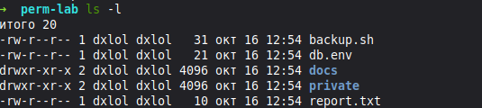
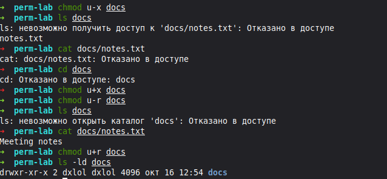
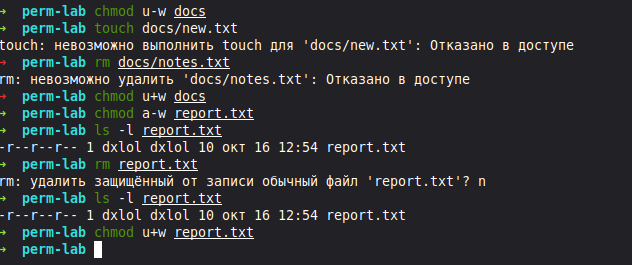
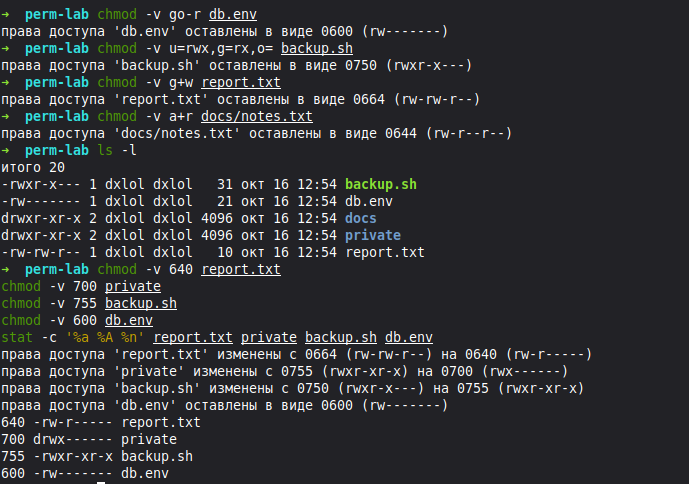
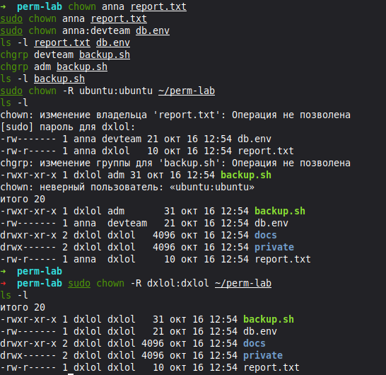
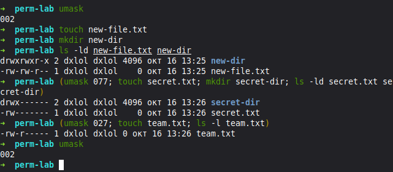
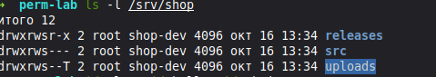
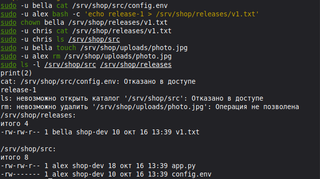
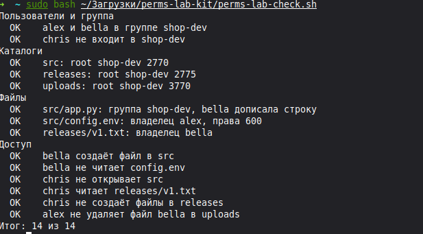

# Права доступа, владельцы и umask · отчёт

Среда: Linux mint Zena (Mate)

## Строка ls -l

Команды:

```bash
ls -l, stat -c …
```



Результат: файлы backup.sh, db.env и report.txt имеют права 644, каталоги docs и private — 755. Владелец и группа — dxlol.

Подпишите поля одной строки: тип, три тройки, владелец, группа.

Вывод: у backup.sh знак - означает обычный файл; rw- даёт владельцу чтение и запись, r-- даёт группе и остальным только чтение.

## Каталог без x и без r

Команды:

```bash
chmod u-x / u-r docs, ls, cat
```



Результат: без x команда ls показывает имя, но не получает сведения о файле; cat и cd получают отказ. Без r команда ls получает отказ, а cat docs/notes.txt выводит Meeting notes.

Объясните каждую ошибку: что запрещено без x и без r.

Вывод: без x нельзя войти в каталог и обратиться к файлу внутри него. Без r нельзя прочитать список имён, но при наличии x можно открыть файл по известному имени.

## Удаление и право w

Команды:

```bash
chmod u-w docs, rm
```



Результат: без w у docs не удалось создать new.txt и удалить notes.txt. После снятия записи с report.txt команда rm запросила подтверждение; ответ n отменил удаление.

Почему удаление файла решает каталог, а не файл.

Вывод: удаление меняет список файлов в каталоге, поэтому нужны w и x у каталога. Право w самого файла отвечает за изменение содержимого, а не за удаление.

## chmod буквами и числом

Команды:

```bash
chmod -v …
```



Результат: итоговые права report.txt — 640, private — 700, backup.sh — 755, db.env — 600.

Переведите три своих примера из букв в число и обратно.

Вывод: u=rw,g=r,o= соответствует 640 и rw-r-----; u=rwx,go= — 700 и rwx------; u=rwx,go=rx — 755 и rwxr-xr-x.

## Владелец и группа

Команды:

```bash
chown, chgrp
```



Результат: chown без sudo получил отказ, с sudo владельцем стала anna. Смена группы backup.sh на devteam запрещена, на adm — разрешена.

Почему chown без sudo запрещён, а chgrp на свою группу разрешён.

Вывод: сменить владельца может администратор. Владелец файла может выбрать группу, в которой состоит: входит в adm, но не в devteam.

## umask

Команды:

```bash
umask, (umask 027; …)
```



Результат: при маске 002 файл получил 664, каталог — 775; при 077 — 600 и 700. При 027 файл team.txt получил 640. Маска основной оболочки осталась 002.

Права файла и каталога при маске 0027 — расчёт по тройкам.

Вывод: маска 0027 не меняет права владельца, убирает w у группы и все права у остальных. Из 666 для файла остаются rw-, r--, --- — 640; из 777 для каталога — rwx, r-x, --- — 750.

## Каталоги проекта

Команды:

```bash
ls -l /srv/shop
```



Результат: все три каталога принадлежат root:shop-dev. Права src — 2770, releases — 2775, uploads — 3770.

Что означает каждая буква в drwxrws--T.

Вывод: d — каталог; rwx — чтение, запись и вход владельцу; rws — те же права группе и setgid для наследования группы. В --T у остальных нет прав, а T означает sticky без x. Удалять файлы могут их владельцы, владелец каталога и root.

## Тесты доступа

Команды:

```bash
sudo -u … cat / ls / rm
```



Результат: bella создала photo.jpg, но не прочитала config.env; alex создал v1.txt, но не удалил photo.jpg; chris прочитал v1.txt, но не открыл src. Владельцем v1.txt стала bella.

Какой бит или право объясняет каждый результат.

Вывод: права 600 закрывают config.env от bella. Права группы w и x разрешают создавать файлы в releases и uploads. У chris есть r у v1.txt и проход через releases, но нет прав на src. Sticky в uploads запрещает alex удалить файл bella.

## Проверка

Команды:

```bash
sudo bash perms-lab-check.sh
```



Результат: итог — 14 из 14

Итог проверки; какие пункты потребовали исправления.

Вывод: пользователи, группы, права и доступ настроены верно. На скриншоте проверки ошибок нет; предыдущие исправления не показаны.

## Перед сдачей

- [x] Проверка: 14 из 14.
- [x] Под каждым снимком есть вывод.
- [x] Учебные каталоги и учётные записи удалены.
