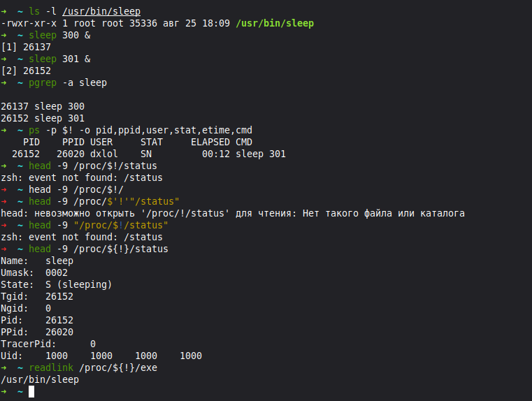
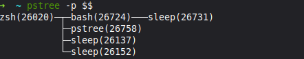
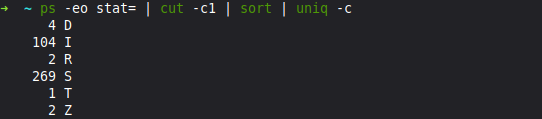
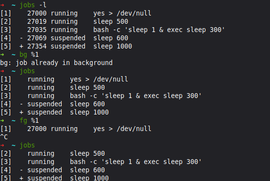
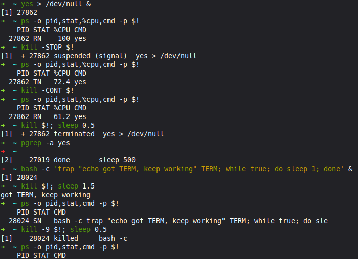
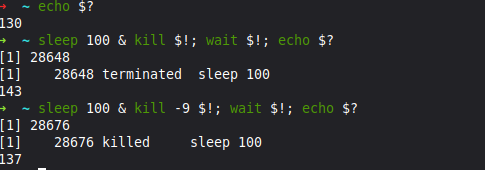
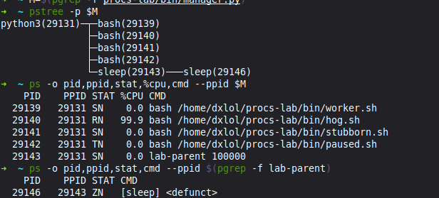
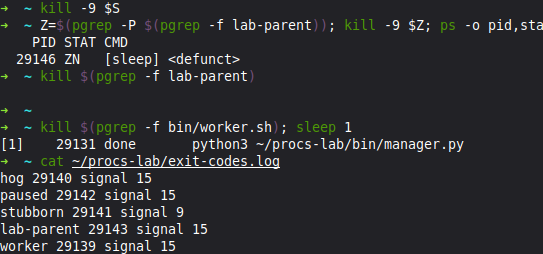
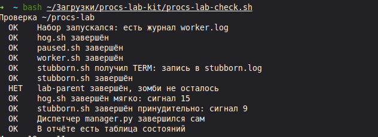

# Процессы: PID, состояния и сигналы · отчёт

Среда: Linux mint Zena (Mate)

## Программа и процесс

Команды:

```bash
sleep 300 &, pgrep -a, /proc/PID/status
```



Результат: sleep 300 имеет PID 26137; sleep 301 — PID 26152, PPID 26020 и состояние S (сон). Оба запущены из /usr/bin/sleep.

Подпишите PID, PPID и состояние; чем процесс отличается от файла программы.

Вывод: PID — номер процесса, PPID — номер его родителя. Программа — файл с кодом, процесс — её запущенный экземпляр со своей памятью, PID и состоянием.

## Дерево процессов

Команды:

```bash
echo $$, pstree -p $$
```



Результат: у zsh (26020) есть потомки bash (26724), pstree (26758), sleep (26137) и sleep (26152). У bash есть потомок sleep (26731).

Подпишите цепочку от оболочки до sleep: кто чей родитель.

Вывод: zsh (26020) — родитель bash (26724), а bash — родитель sleep (26731). Процессы sleep 26137 и 26152 запущены напрямую из zsh.

## Состояния

Команды:

```bash
yes &, sleep &, Ctrl+Z, ps -o stat
```



Результат: найдено 2 процесса R, 269 S, 1 T и 2 Z. Также есть 4 D и 104 I.

Объясните каждое из четырёх состояний и почему появился зомби.

Вывод: R — выполняется или ждёт процессор; S — спит; T — остановлен; Z — завершился, но родитель ещё не забрал результат через wait, поэтому остался зомби. D — непрерываемое ожидание, I — бездействующий поток ядра.

## Фон и передний план

Команды:

```bash
Ctrl+Z, jobs -l, bg, fg
```



Результат: задания 1–3 работают, 4 и 5 остановлены. bg %1 сообщил, что задание уже в фоне. После fg %1 и Ctrl+C процесс yes завершился.

Что делает с заданием каждое действие.

Вывод: Ctrl+Z приостанавливает задание, jobs -l показывает номера, PID и состояния. bg продолжает задание в фоне, fg возвращает его на передний план. Ctrl+C посылает сигнал INT.

## STOP, CONT и trap

Команды:

```bash
kill -STOP, kill -CONT, trap
```



Результат: yes (27862) перешёл из R в T после STOP, вернулся в R после CONT и завершился от TERM. Bash с trap (28024) вывел got TERM, keep working и продолжил работу; KILL завершил его.

Почему процесс пережил TERM и не пережил KILL.

Вывод: STOP приостанавливает процесс, CONT продолжает. Обработчик trap перехватил TERM и не завершил процесс. KILL нельзя перехватить или игнорировать, поэтому процесс завершился принудительно.

## Коды завершения

Команды:

```bash
echo $?, wait $!
```



Результат: получены коды 130 после Ctrl+C, 143 после TERM и 137 после KILL.

Объясните коды 130, 143 и 137.

Вывод: код после завершения сигналом равен 128 плюс номер сигнала: INT 2 даёт 130, TERM 15 — 143, KILL 9 — 137. wait дожидается фонового процесса и возвращает его статус.

## Набор процессов

Команды:

```bash
pstree -p, ps --ppid
```



Результат: диспетчер python3 имеет PID 29131, его потомки — 29139–29143. У lab-parent (29143) есть зомби sleep (29146).

Таблица «процесс — состояние» для набора.

Вывод: [Таблица состояний](states.md)

## Сигналы по заданиям

Команды:

```bash
kill, kill -9, exit-codes.log
```



Результат: в журнале hog, paused, lab-parent и worker завершены сигналом 15, stubborn — сигналом 9. KILL не убрал зомби 29146. После завершения worker диспетчер завершился сам.

Какой сигнал выбран для каждого процесса и почему.

Вывод: для hog, paused, worker и lab-parent выбран TERM для обычного завершения; paused сначала продолжен через CONT. Stubborn игнорирует TERM, поэтому нужен KILL. Зомби уже завершился, KILL не помогает; завершение его родителя позволяет новому родителю забрать результат.

## Проверка

Команды:

```bash
bash correct-procs-lab-check.sh
```



Проблема проверки: посторонний зомби get_apt_cache.p (PID 2140), потомок mintmenu, мешал общесистемной проверке. В [исправленном скрипте проверки](correct-procs-lab-check.sh) проверяется завершение lab-parent без поиска всех зомби системы.

Результат: на скриншоте 10 из 11.

Итог проверки; какие пункты потребовали исправления.

Вывод: в приложенном скрипте исправлен пункт о зомби: посторонние процессы больше не влияют на него.

## Домашние задание

### Что надо было сделать

Напишите скрипт graceful.sh, который при запуске создаёт временный файл /tmp/graceful-$$.tmp, затем работает в бесконечном цикле со sleep 1. На сигнал TERM скрипт должен удалить свой временный файл и выйти с кодом 0 — команда trap из части 5.

- Запустите скрипт в фоне, пошлите TERM, получите код через wait $! и покажите, что временного файла нет.

- Запустите ещё раз и пошлите KILL: покажите код 137 и оставшийся временный файл. Объясните разницу двумя-тремя предложениями.

- Выведите цепочку процессов от PID 1 до своей оболочки командой pstree -s -p $$ и подпишите каждое звено: что это за программа.

### Решение

1) [Скрипт graceful.sh](graceful.sh)

2) В фоне c TERM

```bash
hw git:(main) ✗ wait $SCRIPT_PID 
echo "Код возврата: $?"
Код возврата: 0
➜  hw git:(main) ✗ ls -l /tmp/graceful-$SCRIPT_PID.tmp
ls: невозможно получить доступ к '/tmp/graceful-41820.tmp': Нет такого файла или каталога
```

3) C Kill

```bash
➜  hw git:(main) ✗ kill -9 $SCRIPT_PID
[1]  + 45153 killed     ./graceful.sh                            
➜  hw git:(main) ✗ wait $SCRIPT_PID
echo "Код возврата: $?"
Код возврата: 137
➜  hw git:(main) ✗ ls -l /tmp/graceful-$SCRIPT_PID.tmp
-rw-rw-r-- 1 dxlol dxlol 0 окт 16 16:45 /tmp/graceful-45153.tmp
➜  hw git:(main) ✗ 
```

Разница: TERM запрос на завершение, а kill -9 немеленое. Term можно перехватить с помощью trap в отличие от kill -9 которое обрабатывается ядром.

4) цепочка процессов

```bash
systemd(1)───code(4710)───code(5307)───zsh(41299)───pstree(46743+)
```

systemd(1) - главный процесс системы.
code(4710) - родительский процесс VS code.
code(5307) - дочерний процесс встроенного терминала.
zsh(41299) - оболочка терминала Zsh.
pstree(46743+) - утилита которая вывела цепочку.

## Перед сдачей

- [x] Проверка: 11 из 11;
- [x] Под каждым снимком есть вывод.
- [x] [Таблица состояний](states.md) заполнена.
