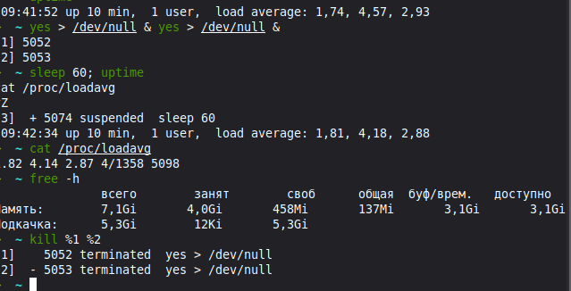
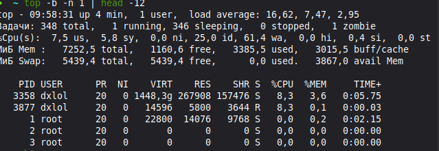
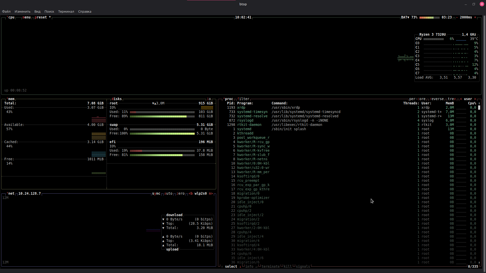
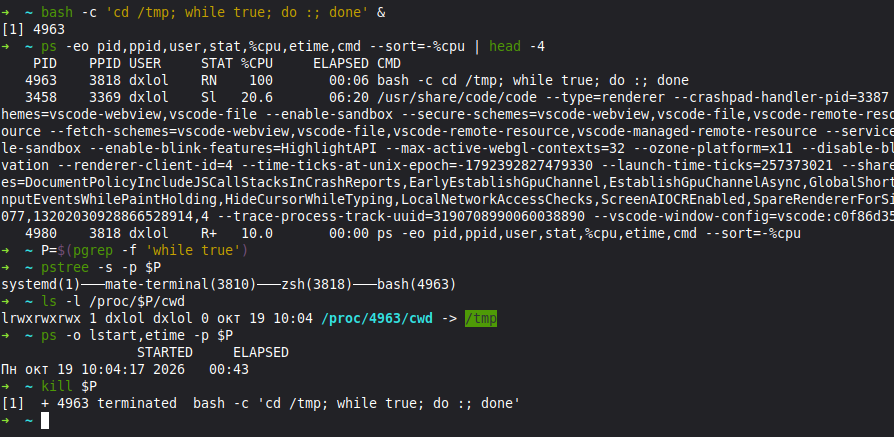
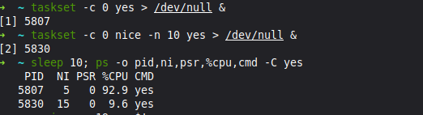
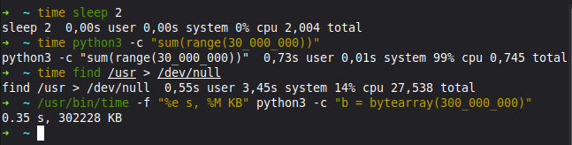
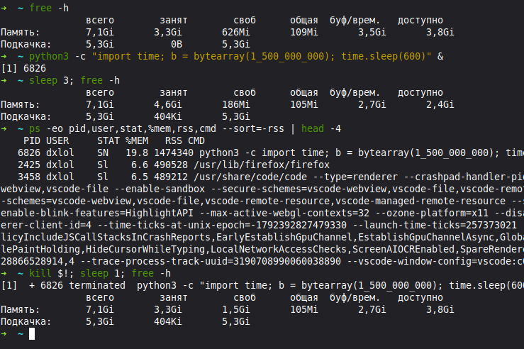
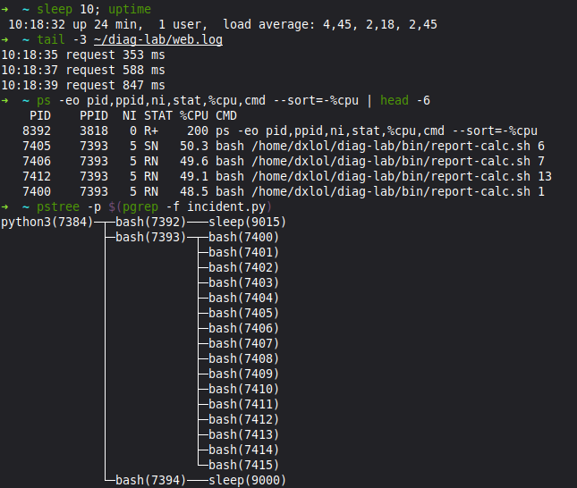
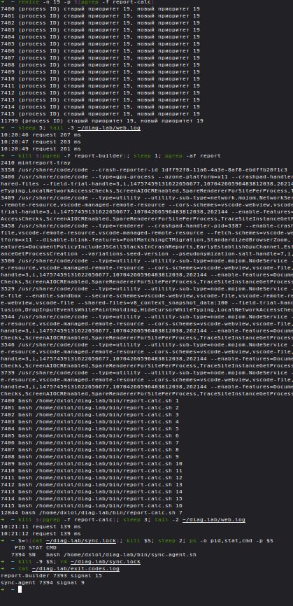
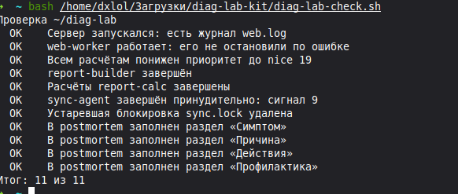

# Диагностика процессов и управление ресурсами · отчёт

Среда: Linux mint Zena (Mate)

## Нагрузка

Команды:

```bash
nproc, uptime, /proc/loadavg, free -h
```



Результат: до запуска yes нагрузка была 1,74 / 4,57 / 2,93, после — 1,81 / 4,18 / 2,88. Доступно 3,1 ГиБ памяти.

Сравните load average с числом ядер до и после запуска yes.

Вывод: на снимке btop видно 8 логических процессоров. Минутная нагрузка выросла с 1,74 до 1,81 и осталась ниже 8. Load average меняется постепенно, поэтому рост виден не сразу.

## top

Команды:

```bash
top -b -n 1 | head -12
```



Результат: load average — 16,62 / 7,47 / 2,95; us — 7,5%, wa — 61,4%. PID 3358 и 3877 используют по 8,3% CPU.

Подпишите нагрузку, долю us и самый загруженный процесс.

Вывод: us — доля CPU на пользовательский код. Наибольшая видимая загрузка у PID 3358 и 3877, их имена обрезаны. Высокое wa указывает на ожидание ввода-вывода.

## htop | btop

Команды:

```bash
btop
```



Результат: загрузка отдельных процессоров — 3–12%, общая — 6%. Занято 3,07 ГиБ из 7,08 ГиБ, доступно 4 ГиБ. Подкачка не используется.

Что показывают полосы ядер и памяти.

Вывод: полосы CPU показывают загрузку каждого логического процессора, полосы памяти — занятое место, свободную память и кэш. Available учитывает память, которую система может освободить из кэша.

## Поиск виновника

Команды:

```bash
ps --sort=-%cpu, pstree -s -p, /proc/PID/cwd
```



Результат: bash с PID 4963 и PPID 3818 занял 100% CPU. Его рабочий каталог — /tmp.

PID виновника, кто его запустил и где он работает.

Вывод: виновник — бесконечный цикл bash (4963). Его запустил пользователь dxlol из zsh (3818), работающей в mate-terminal (3810). Ссылка /proc/4963/cwd указывает на /tmp.

## nice и renice

Команды:

```bash
taskset, nice, renice
```



Результат: оба yes работают на CPU 0. У PID 5807 nice 5 и 92,9% CPU, у PID 5830 nice 15 и 9,6% CPU. Отказ renice на снимке не показан.

Почему ядро разделилось 90 на 10 и почему renice отказал.

Вывод: при конкуренции на одном процессоре меньшее nice даёт большую долю CPU, поэтому получилось примерно 90 на 10. Снижение nice повышает приоритет и обычно требует sudo; без нужных прав renice получает отказ.

## time

Команды:

```bash
time, /usr/bin/time -f
```



Результат: sleep занял 2,004 с, расчёт Python — 0,745 с, find — 27,538 с. Выделение 300 МБ заняло 0,35 с, пиковая память — 302228 КиБ.

Соотношение real, user и sys для каждой команды.

Вывод: у sleep user и sys равны 0 при real 2,004 с — ожидание. У расчёта user 0,73 с и sys 0,01 с почти равны real — работа CPU. У find user 0,55 с и sys 3,45 с намного меньше real — преобладает ожидание.

## Память

Команды:

```bash
free -h, ps --sort=-rss
```



Результат: Python (PID 6826) занял RSS 1474340 КиБ, около 1,4 ГиБ. Доступная память снизилась с 3,8 до 2,4 ГиБ, после завершения процесса вернулась к 3,8 ГиБ.

Сколько памяти занял процесс и вернулась ли она.

Вывод: процесс выделил массив размером 1,5 млрд байт. После TERM система освободила его память; возврат available к 3,8 ГиБ подтверждает это.

## Инцидент: симптом

Команды:

```bash
uptime, tail web.log, ps, pstree
```



Результат: в 10:18 ответы заняли 353, 588 и 847 мс; load average — 4,45 / 2,18 / 2,45. Видимые процессы report-calc используют около 49–50% CPU каждый.

Симптом в числах и виновники.

Вывод: report-builder (PID 7393) запустил 16 процессов report-calc, которые конкурируют с web-worker за CPU. Отдельная проблема — sync-agent (PID 7394), удерживающий sync.lock и не завершающийся по TERM.

## Инцидент: исправление

Команды:

```bash
renice, kill, kill -9, exit-codes.log
```



Результат: после назначения nice 19 ответы заняли 207–263 мс. После завершения расчётов — 139 мс. В журнале report-builder завершён сигналом 15, sync-agent — сигналом 9; sync.lock удалён.

Что сделано и как изменилось время ответа.

Вывод: снижение приоритета уменьшило задержку, завершение расчётов снизило её до 139 мс. TERM завершил report-builder, но оставшиеся расчёты пришлось убрать отдельно через KILL. Sync-agent пережил TERM, поэтому применён KILL и удалена устаревшая блокировка.

## Проверка

Команды:

```bash
bash diag-lab-check.sh
```



Результат: итог — 11 из 11, все пункты отмечены OK.

Итог проверки; какие пункты потребовали исправления.

Вывод:

## Перед сдачей

- [x] Проверка: 11 из 11.
- [x] Под каждым снимком есть вывод.
- [x] postmortem.md заполнен.
