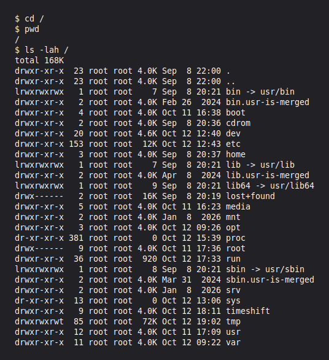
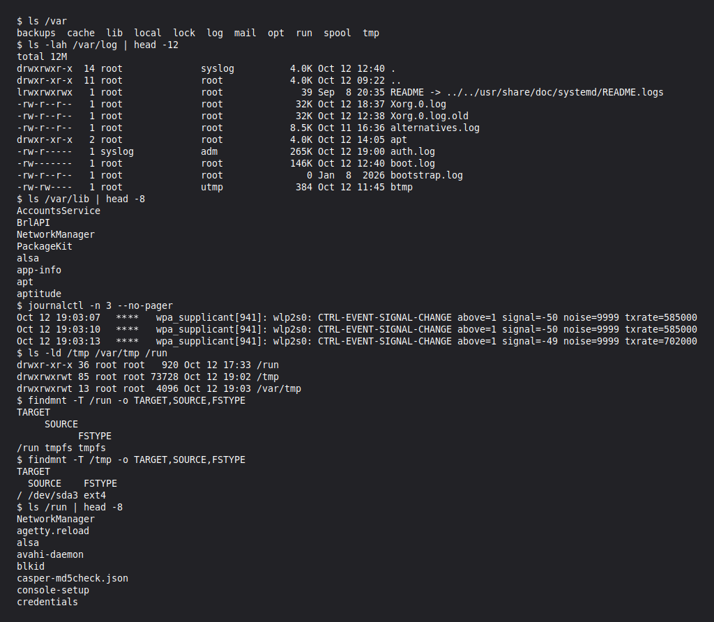
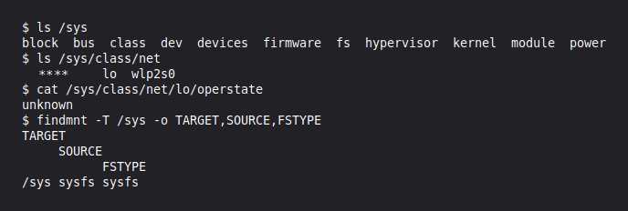
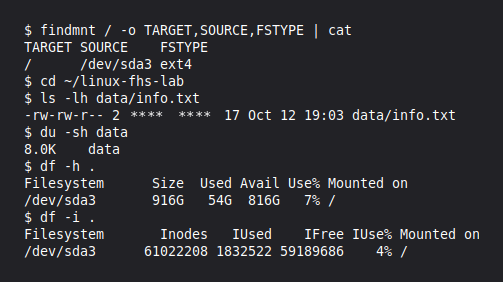
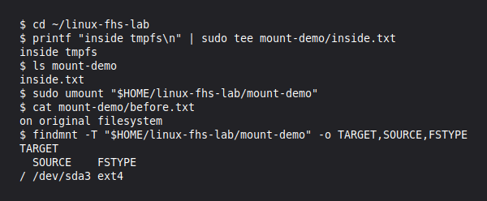
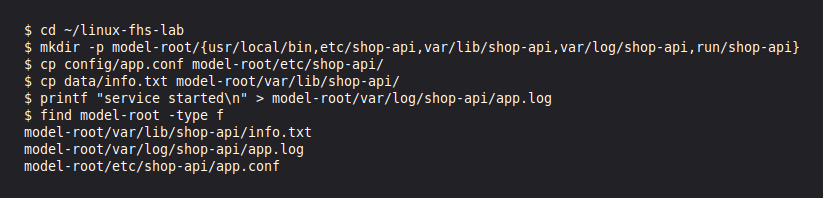

# Файловая система Linux · отчёт

Среда: установленная Linux Mint 22.3 (Zena), MATE Terminal.
Личные данные в тексте, логах и снимках заменены на `****`.

## Корневой каталог

Команды:

```bash
pwd, ls -lah /
```



Результат:

```text
/

total 168K
drwxr-xr-x  23 root root 4.0K Sep  8 22:00 .
drwxr-xr-x  23 root root 4.0K Sep  8 22:00 ..
lrwxrwxrwx   1 root root    7 Sep  8 20:21 bin -> usr/bin
drwxr-xr-x   2 root root 4.0K Feb 26  2024 bin.usr-is-merged
drwxr-xr-x   4 root root 4.0K Oct 11 16:38 boot
drwxr-xr-x   2 root root 4.0K Sep  8 20:36 cdrom
drwxr-xr-x  20 root root 4.6K Oct 12 12:40 dev
drwxr-xr-x 153 root root  12K Oct 12 12:43 etc
drwxr-xr-x   3 root root 4.0K Sep  8 20:37 home
lrwxrwxrwx   1 root root    7 Sep  8 20:21 lib -> usr/lib
drwxr-xr-x   2 root root 4.0K Apr  8  2024 lib.usr-is-merged
lrwxrwxrwx   1 root root    9 Sep  8 20:21 lib64 -> usr/lib64
drwx------   2 root root  16K Sep  8 20:19 lost+found
drwxr-xr-x   5 root root 4.0K Oct 11 16:23 media
drwxr-xr-x   2 root root 4.0K Jan  8  2026 mnt
drwxr-xr-x   3 root root 4.0K Oct 12 09:26 opt
dr-xr-xr-x 381 root root    0 Oct 12 15:39 proc
drwx------   9 root root 4.0K Oct 11 17:36 root
drwxr-xr-x  36 root root  920 Oct 12 17:33 run
lrwxrwxrwx   1 root root    8 Sep  8 20:21 sbin -> usr/sbin
drwxr-xr-x   2 root root 4.0K Mar 31  2024 sbin.usr-is-merged
drwxr-xr-x   2 root root 4.0K Jan  8  2026 srv
dr-xr-xr-x  13 root root    0 Oct 12 13:06 sys
drwxr-xr-x   9 root root 4.0K Oct 12 18:11 timeshift
drwxrwxrwt  85 root root  72K Oct 12 19:02 tmp
drwxr-xr-x  12 root root 4.0K Oct 11 17:09 usr
drwxr-xr-x  11 root root 4.0K Oct 12 09:22 var
```

Что такое корневой каталог, чем абсолютный путь отличается от относительного.

Вывод: Корень `/` — начало дерева файлов; абсолютный путь начинается с `/`, относительный отсчитывается от текущего каталога.

## Домашний каталог

Команды:

```bash
cd ~, pwd, ls -a
```


Результат:

```text
/home/****

/home/****

 linux-fhs-lab	 prodject   Видео   Документы   Загрузки   Изображения	 Музыка   Общедоступные  'Рабочий стол'   Шаблоны

 .		 .cache     .gitconfig	  .linuxmint   .sentry-native		   .vscode			 .zsh_history	 Загрузки
 ..		 .codex     .gnupg	  .local       .shell.pre-oh-my-zsh	   .vscode-shared		 .zshrc		 Изображения
 .Xauthority	 .config    .gtkrc-2.0	  .mozilla     .ssh			   .xsession-errors		 linux-fhs-lab	 Музыка
 .bash_history	 .copilot   .gtkrc-xfce   .oh-my-zsh   .sudo_as_admin_successful   .xsession-errors.old		 prodject	 Общедоступные
 .bash_logout	 .dmrc	    .icons	  .profile     .themes			   .zcompdump-****-5.9	 Видео		'Рабочий стол'
 .bashrc	 .dotnet    .lesshst	  .qt	       .var			   .zcompdump-****-5.9.zwc	 Документы	 Шаблоны

root:x:0:0:root:/root:/bin/bash
```

Где находится домашний каталог, что такое скрытые файлы.

Вывод: Домашний каталог — `/home/****`; скрытые имена начинаются с точки и видны через `ls -a`.

## Каталог /etc

Команды:

```bash
cat /etc/os-release; getent passwd
```


Результат:

```text
NAME="Linux Mint"
VERSION="22.3 (Zena)"
ID=linuxmint
ID_LIKE="ubuntu debian"
PRETTY_NAME="Linux Mint 22.3"
VERSION_ID="22.3"
HOME_URL="https://www.linuxmint.com/"
SUPPORT_URL="https://forums.linuxmint.com/"
BUG_REPORT_URL="http://linuxmint-troubleshooting-guide.readthedocs.io/en/latest/"
PRIVACY_POLICY_URL="https://www.linuxmint.com/"
VERSION_CODENAME=zena
UBUNTU_CODENAME=noble

****

127.0.0.1	localhost
127.0.1.1	****

# The following lines are desirable for IPv6 capable hosts
::1     ip6-localhost ip6-loopback
fe00::0 ip6-localnet
ff00::0 ip6-mcastprefix
ff02::1 ip6-allnodes
ff02::2 ip6-allrouters

****:x:1000:1000:****,,,:/home/****:/usr/bin/zsh
```

Версия системы, UID, домашний каталог и оболочка.

Вывод: Linux Mint 22.3; UID — `1000`, домашний каталог — `/home/****`, оболочка — `/usr/bin/zsh`.

## Программы и PATH

Команды:

```bash
command -v, type, echo $PATH
```


Результат:

```text
/usr/bin/python3

cd is a shell builtin

ls is /usr/bin/ls

/home/****/.codex/tmp/arg0/****
/home/****/.cache/codex-runtimes/codex-primary-runtime/dependencies/bin/override
/usr/local/sbin
/usr/local/bin
/usr/sbin
/usr/bin
/sbin
/bin
/usr/games
/usr/local/games
/snap/bin
/home/****/.cache/codex-runtimes/codex-primary-runtime/dependencies/bin/fallback
/usr/lib/chatgpt/resources

Python 3.12.3
```

Как оболочка находит программу.

Вывод: Оболочка проверяет каталоги `PATH` слева направо и запускает первую найденную программу.

## Изменяемые данные

Команды:

```bash
ls /var; findmnt -T /run
```



Результат:

```text
backups  cache	lib  local  lock  log  mail  opt  run  spool  tmp

total 12M
drwxrwxr-x  14 root              syslog          4.0K Oct 12 12:40 .
drwxr-xr-x  11 root              root            4.0K Oct 12 09:22 ..
lrwxrwxrwx   1 root              root              39 Sep  8 20:35 README -> ../../usr/share/doc/systemd/README.logs
-rw-r--r--   1 root              root             32K Oct 12 18:37 Xorg.0.log
-rw-r--r--   1 root              root             32K Oct 12 12:38 Xorg.0.log.old
-rw-r--r--   1 root              root            8.5K Oct 11 16:36 alternatives.log
drwxr-xr-x   2 root              root            4.0K Oct 12 14:05 apt
-rw-r-----   1 syslog            adm             265K Oct 12 19:00 auth.log
-rw-------   1 root              root            146K Oct 12 12:40 boot.log
-rw-r--r--   1 root              root               0 Jan  8  2026 bootstrap.log
-rw-rw----   1 root              utmp             384 Oct 12 11:45 btmp

AccountsService
BrlAPI
NetworkManager
PackageKit
alsa
app-info
apt
aptitude

Oct 12 19:03:07 **** wpa_supplicant[941]: wlp2s0: CTRL-EVENT-SIGNAL-CHANGE above=1 signal=-50 noise=9999 txrate=585000
Oct 12 19:03:10 **** wpa_supplicant[941]: wlp2s0: CTRL-EVENT-SIGNAL-CHANGE above=1 signal=-50 noise=9999 txrate=585000
Oct 12 19:03:13 **** wpa_supplicant[941]: wlp2s0: CTRL-EVENT-SIGNAL-CHANGE above=1 signal=-49 noise=9999 txrate=702000

drwxr-xr-x 36 root root   920 Oct 12 17:33 /run
drwxrwxrwt 85 root root 73728 Oct 12 19:02 /tmp
drwxrwxrwt 13 root root  4096 Oct 12 19:03 /var/tmp

TARGET
     SOURCE
           FSTYPE
/run tmpfs tmpfs

TARGET
  SOURCE    FSTYPE
/ /dev/sda3 ext4

NetworkManager
agetty.reload
alsa
avahi-daemon
blkid
casper-md5check.json
console-setup
credentials
```

Назначение /var/lib, /var/log, /var/cache и /run.

Вывод: `/var/lib` — постоянные данные, `/var/log` — журналы, `/var/cache` — кэш, `/run` — данные текущего запуска.

## Устройства

Команды:

```bash
ls -l /dev/null; echo $?
```


Результат:

```text
crw-rw-rw- 1 root root 1, 3 Oct 12 12:40 /dev/null
crw-rw-rw- 1 root root 1, 5 Oct 12 12:40 /dev/zero

/dev/null: character special (1/3)

exit status: 0

NAME        TYPE   SIZE MOUNTPOINTS
sda         disk 931.5G
├─sda1      part   476M
├─sda2      part     1M /media/****/UEFI_NTFS
└─sda3      part   931G /
zram0       disk   3.5G [SWAP]
nvme0n1     disk 476.9G
├─nvme0n1p1 part   200M /boot/efi
├─nvme0n1p2 part    16M
├─nvme0n1p3 part 475.9G
└─nvme0n1p4 part   857M
```

Тип устройства и код завершения.

Вывод: `/dev/null` — символьное устройство (`c`); код завершения `0` означает успех.

## Файлы /proc

Команды:

```bash
cat /proc/uptime; cp; sleep 5
```


Результат:

```text
-r--r--r-- 1 root root 0 Oct 12 19:00 /proc/uptime

23030.70 91686.15

23035.71 91722.76

23030.71 91686.17

-r--r--r-- 1 **** **** 18 Oct 12 19:03 saved-uptime.txt

/proc  proc

/      ext4
```

Почему копия не меняется.

Вывод: Копия хранит значения на момент копирования, а содержимое `/proc` ядро формирует при чтении.

## Сетевые интерфейсы

Команды:

```bash
ls /sys/class/net
```



Результат:

```text
block  bus  class  dev	devices  firmware  fs  hypervisor  kernel  module  power

****  lo  wlp2s0

unknown

TARGET
     SOURCE
           FSTYPE
/sys sysfs sysfs
```

Какие интерфейсы есть в системе.

Вывод: В системе есть `****`, `lo` и `wlp2s0`; `lo` — локальный интерфейс.

## inode и ссылки

Команды:

```bash
ls -li; rm data/info.txt; cat info-link.txt
```


Результат:

```text
31072740 -rw-rw-r-- 2 **** **** 17 Oct 12 19:03 data/info-hard.txt
31072740 -rw-rw-r-- 2 **** **** 17 Oct 12 19:03 data/info.txt
31099405 lrwxrwxrwx 1 **** **** 13 Oct 12 19:03 info-link.txt -> data/info.txt

31072740 -rw-rw-r-- 1 **** **** 17 Oct 12 19:03 data/info-hard.txt
31099405 lrwxrwxrwx 1 **** **** 13 Oct 12 19:03 info-link.txt -> data/info.txt

cat: info-link.txt: No such file or directory

Linux filesystem

Linux filesystem

31072740 -rw-rw-r-- 2 **** **** 17 Oct 12 19:03 data/info-hard.txt
31072740 -rw-rw-r-- 2 **** **** 17 Oct 12 19:03 data/info.txt
```

Чем жёсткая ссылка отличается от символической.

Вывод: Жёсткая ссылка указывает на тот же inode, символическая хранит путь и ломается после удаления файла по этому пути.

## Место на диске

Команды:

```bash
findmnt /; df -h .; du -sh data
```



Результат:

```text
TARGET SOURCE    FSTYPE
/      /dev/sda3 ext4

-rw-rw-r-- 2 **** **** 17 Oct 12 19:03 data/info.txt

8.0K	data

Filesystem      Size  Used Avail Use% Mounted on
/dev/sda3       916G   54G  816G   7% /

Filesystem       Inodes   IUsed    IFree IUse% Mounted on
/dev/sda3      61022208 1832522 59189686    4% /
```

Чем df отличается от du.

Вывод: `df` показывает место всей файловой системы, `du` — место, занятое файлами и каталогами.

## Монтирование tmpfs

Команды:

```bash
findmnt -T mount-demo
```


Результат:

```text
before.txt

TARGET                               SOURCE
                                           FSTYPE
/home/****/linux-fhs-lab/mount-demo tmpfs tmpfs

total 4
drwxrwxrwt 2 root  root    40 Oct 12 19:03 .
drwxrwxr-x 8 **** **** 4096 Oct 12 19:03 ..
```

Почему before.txt перестал быть виден.

Вывод: tmpfs скрыла прежнее содержимое точки монтирования; `before.txt` остался на диске и не был удалён.

## Отключение tmpfs

Команды:

```bash
cat mount-demo/before.txt
```



Результат:

```text
inside tmpfs

inside.txt

on original filesystem

TARGET
  SOURCE    FSTYPE
/ /dev/sda3 ext4
```

Что стало с inside.txt.

Вывод: `inside.txt` исчез после отключения tmpfs, а `before.txt` снова стал виден.

## Файлы shop-api

Команды:

```bash
find model-root -type f
```



Результат:

```text
model-root/var/lib/shop-api/info.txt
model-root/var/log/shop-api/app.log
model-root/etc/shop-api/app.conf
```

Почему выбран каждый каталог.

Вывод: `/etc` — настройки, `/var/lib` — данные, `/var/log` — журналы, `/usr/local/bin` — программа, `/run` — номер процесса.

## Размещение shop-api

| Файл | Путь | Основание |
|---|---|---|
| Исполняемый файл | `/usr/local/bin/shop-api` | Установлен вручную |
| Настройки | `/etc/shop-api/app.conf` | Конфигурация службы |
| База данных | `/var/lib/shop-api/database.db` | Постоянные изменяемые данные |
| Журнал | `/var/log/shop-api/app.log` | Записи о работе |
| Номер процесса | `/run/shop-api/shop-api.pid` | Данные текущего запуска |
| Промежуточные файлы | `/tmp` | Кратковременные данные |

## Итоговая задача

| Исходный путь | Решение и правильный путь | Основание, часть урока |
|---|---|---|
| `/home/admin/shop.log` | Заменить на `/var/log/shop-api/shop.log` | Журнал, часть 4 |
| `/usr/bin/config.json` | Заменить на `/etc/shop-api/config.json` | Настройки, часть 2 |
| `/tmp/database.db` | Заменить на `/var/lib/shop-api/database.db` | База должна сохраняться, часть 4 |
| `/etc/shop-api/app.conf` | Оставить | Настройки, часть 2 |
| `/var/log/shop-api/access.log` | Оставить | Журнал, часть 4 |
| `/var/lib/shop-api/database.db` | Оставить | Постоянные данные, часть 4 |

## Домашнее задание: backup-agent

| Файл | Путь | Основание |
|---|---|---|
| Программа | `/usr/local/bin/backup-agent` | Установлена вручную |
| Настройки | `/etc/backup-agent/agent.conf` | Конфигурация |
| Журнал | `/var/log/backup-agent/agent.log` | Результаты работы и ошибки |
| Список сделанных копий | `/var/lib/backup-agent/catalog.json` | Постоянные данные службы |
| Номер процесса | `/run/backup-agent/agent.pid` | Данные текущего запуска |

Сами копии следует хранить на постоянном носителе, например в `/mnt/backup`, если туда подключён отдельный диск.

## Перед сдачей

- [x] Практика выполнена в `~/linux-fhs-lab`, существующие файлы без указаний задания сохранены.
- [x] tmpfs отключена, `before.txt` снова доступен.
- [x] Все 13 новых снимков открываются, результаты приведены в блоках кода.
- [x] На каждый вопрос дан короткий ответ после `Вывод:`.
- [x] Работа сохранена в репозитории на постоянном диске.
